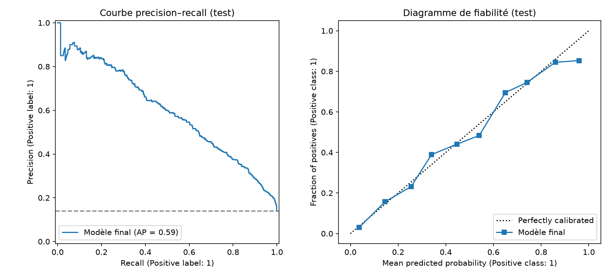
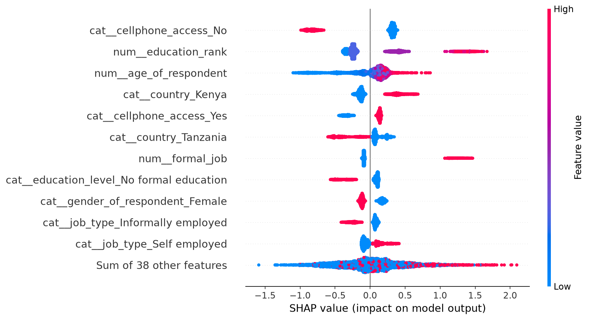
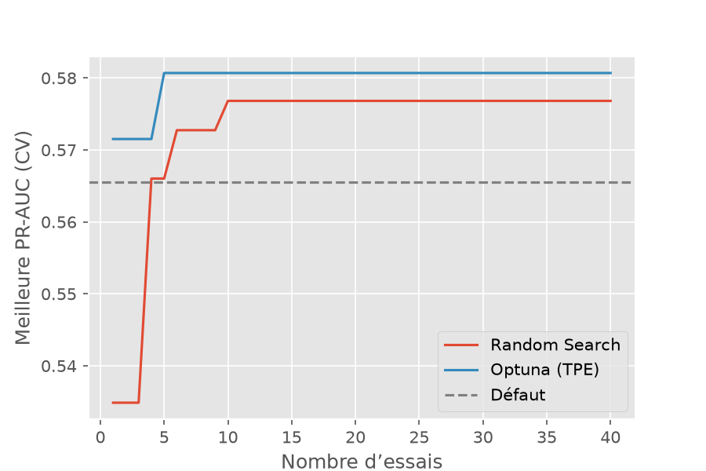

# Inclusion financière en Afrique de l'Est : qui possède un compte bancaire ?

Prédire si une personne possède un compte bancaire (Kenya, Rwanda, Tanzanie, Ouganda) à partir de ses caractéristiques socio-économiques, avec un protocole d'évaluation sans fuite, des hyperparamètres optimisés, une calibration vérifiée et un seuil de décision fondé sur les coûts.

**Résultat principal** : le modèle retenu (LightGBM réglé avec Optuna, calibration isotone) obtient sur le test, évalué une seule fois, une **PR-AUC de 0,594 (IC 95 % : 0,556 à 0,632)** et une ROC-AUC de 0,876. Au seuil de 0,091 fixé par les coûts, le coût total est de **1 040,5 USD**, contre 2 021,5 USD en contactant tout le monde et 3 310 USD en ne contactant personne.

Projet du Module 5 « Évaluer et optimiser les modèles de machine learning » (AIMS Sénégal, formateur : Karim Mache).

---

## Problème

**Scénario (fictif).** KaziPay lance un service de paiement mobile relié à un compte bancaire. Elle veut contacter, par SMS puis appel d'un agent, les personnes **déjà bancarisées**, seules à pouvoir souscrire immédiatement.

- **Unité statistique** : une personne enquêtée. **Cible** : `bank_account` (Yes = 1). **Classe positive** : la personne a un compte. **Type de problème** : classification binaire déséquilibrée.
- **Coûts** (hypothèses pédagogiques, fixées dans `config.py`) :
  - contacter une personne sans compte : faux positif, **0,5 USD** ;
  - ne pas contacter une personne bancarisée : faux négatif, **5 USD**.
- **Seuil théorique** si les probabilités sont calibrées : `t* = C_FP / (C_FP + C_FN) = 0,5 / 5,5 ≈ 0,091`. Il est bien inférieur à 0,5 car un oubli coûte 10 fois plus qu'un contact inutile. Si `C_FN` tombait à 2 USD, `t*` passerait à 0,2.
- **Second usage** : la banque centrale veut estimer le nombre de personnes bancarisées par pays en additionnant les probabilités prédites. Cela exige des probabilités **calibrées**, d'où la place de la calibration dans ce projet.

**Métriques.**

| Rôle | Métrique | Pourquoi |
|---|---|---|
| Principale | **PR-AUC** (average precision) | classe positive rare (14 %), le hasard vaut la prévalence (≈ 0,14) |
| Secondaire | ROC-AUC | qualité du classement |
| Secondaire | Brier (et ECE) | qualité des probabilités, utile pour la décision et le comptage |

L'accuracy n'est pas retenue : répondre « Non » pour tout le monde donne environ 86 % d'accuracy avec un recall nul.

## Données

- **Source** : compétition « Financial Inclusion in Africa » (Zindi), issue des enquêtes FinScope 2016-2018 au Kenya, au Rwanda, en Tanzanie et en Ouganda.
- **Taille** : 23 524 lignes, 13 colonnes, aucune valeur manquante. **3 312 personnes bancarisées (14,08 %)**.
- **Découpage** : 18 819 lignes en entraînement, 4 705 en test, même prévalence (≈ 14,1 %) dans les deux.
- **Pièges identifiés** :
  - `uniqueid` retirée : identifiant sans valeur explicative ;
  - `year` retirée : quasi confondue avec le pays, elle n'apporte pas une évolution temporelle d'une même population ;
  - profils identiques avec étiquettes contradictoires : bruit irréductible qui plafonne les performances ;
  - modalités rares : regroupées par l'encodeur (`min_frequency=20`).
  Les chiffres détaillés se trouvent dans `notebooks/01_exploration.ipynb`.
- **Téléchargement** : créer un compte gratuit sur [zindi.africa](https://zindi.africa), ouvrir la compétition *Financial Inclusion in Africa*, onglet *Data*, télécharger le fichier d'entraînement et `VariableDefinitions.csv`. Les données ne sont pas versionnées, conformément aux conditions d'utilisation de Zindi.

## Installation

```bash
git clone https://github.com/abdoulmouhamed99/inclusion-financiere.git
cd inclusion-financiere
uv sync
```

Placer le fichier d'entraînement sous le nom `inclusion-financiere-en-afrique.csv` (et `VariableDefinitions.csv`) dans `data/raw/`.

## Reproduction

Exécuter les notebooks **dans l'ordre** avec `uv run jupyter lab`, puis lancer les tests :

| Notebook | Contenu |
|---|---|
| `01_exploration` | contexte, taux de bancarisation, pièges |
| `02_preparation_protocole` | variables, pipeline, split, CV stratifiée, pays jamais vu |
| `03_baselines_ensembles` | baselines, biais-variance, comparaison des ensembles |
| `04_hyperparametres` | Random Search et Optuna |
| `05_calibration_seuil` | calibration (ECE, Brier), seuil selon les coûts |
| `06_test_final_interpretation` | test final unique, permutation, SHAP, genre |

```bash
uv run pytest
```

Les graines sont fixées (`random_state = 42`), donc les résultats sont reproductibles.

## Structure du dépôt

```text
inclusion-financiere/
├── notebooks/            # 6 notebooks numérotés
├── src/inclusion_financiere/
│   ├── config.py         # chemins, graine, coûts métier
│   ├── data.py           # chargement, nettoyage, split train/test
│   ├── features.py       # variables métier et préprocesseurs
│   ├── pipeline.py       # pipelines scikit-learn sans fuite
│   ├── pipeline_catboost.py  # CatBoost avec catégories natives
│   └── evaluate.py       # CV, ECE, coût, bootstrap
├── reports/              # tableaux et figures exportées
└── tests/                # tests unitaires
```

## Méthode

1. **Préparation** : `uniqueid`, `year` et la cible retirées des variables. Variables ajoutées sans apprentissage : `education_rank`, `is_head`, `formal_job`, `urban_phone`, `age_group`, et `age_squared` (variable personnelle, justifiée par un effet de cycle de vie). Tout ce qui apprend des données (encodage, standardisation) est dans le pipeline, donc ajusté dans chaque pli.
2. **Protocole** : découpage 80/20 stratifié, **test sous scellé** jusqu'à l'étape finale ; validation croisée stratifiée à 5 plis, **un seul objet `cv` pour tous les modèles** ; toujours moyenne ± écart-type ; expérience par pays jamais vu avec `StratifiedGroupKFold`.
3. **Modèles comparés** : Dummy, régression logistique (avec et sans nouvelles variables), Random Forest, HistGB, XGBoost, LightGBM, CatBoost (catégories natives).
4. **Réglage** : LightGBM, 40 essais par méthode (Random Search et Optuna TPE), métrique PR-AUC, même `cv`.
5. **Calibration** : diagramme de fiabilité, ECE et Brier avant et après Platt et isotone, sur des prédictions hors pli.
6. **Seuil** : seuil théorique `t*` comparé au seuil 0,5, à un seuil appris, et aux stratégies sans modèle.
7. **Test final** : pipeline réentraîné sur tout le train, test ouvert **une seule fois**, IC 95 % par bootstrap (1 000 rééchantillonnages).
8. **Interprétation** : importance par permutation et SHAP.

## Résultats

### Comparaison en validation croisée (5 plis, réglages par défaut)

| Modèle | PR-AUC validation | PR-AUC entraînement | ROC-AUC | Brier | Temps (s) |
|---|---|---|---|---|---|
| Random Forest (`min_samples_leaf` réglé) | 0,565 ± 0,028 | 0,590 | 0,854 | 0,0876 | 2,4 |
| HistGB | 0,568 ± 0,024 | 0,670 | 0,857 | 0,0858 | 1,1 |
| XGBoost | 0,543 ± 0,023 | 0,793 | 0,844 | 0,0898 | 0,9 |
| LightGBM | 0,565 ± 0,025 | 0,709 | 0,854 | 0,0864 | 0,5 |
| CatBoost natif | 0,582 ± 0,024 | 0,661 | 0,863 | 0,0844 | 132,4 |

*Baselines (Dummy, régression logistique) : voir `notebooks/03_baselines_ensembles.ipynb`. Un modèle aléatoire a une PR-AUC égale à la prévalence (≈ 0,14).*

Aucun vainqueur net : les écarts entre Random Forest, HistGB et LightGBM sont inférieurs à l'écart-type. CatBoost a un léger avantage régulier (+0,017 vs Random Forest) mais est environ 250 fois plus lent. XGBoost surapprend le plus (0,793 en entraînement contre 0,543 en validation). **LightGBM est retenu** : performant, très rapide, et marge de gain par régularisation.

### Réglage des hyperparamètres (LightGBM)

| Configuration | PR-AUC (CV) | Gain vs défaut |
|---|---|---|
| Défaut | 0,5655 | n/a |
| Random Search (40 essais) | 0,5768 | +0,011 |
| **Optuna TPE (40 essais)** | **0,5807** | +0,015 |

Les gains restent **inférieurs à un écart-type** (≈ 0,025) : le réglage améliore peu, car le plafond de ce jeu est bas (bruit irréductible). Les deux recherches convergent vers des modèles **fortement régularisés** (6 à 17 feuilles, `reg_lambda` élevé). Les hyperparamètres les plus influents sont `colsample_bytree` et `num_leaves`. `best_score_` est optimiste : l'estimation honnête vient du test.

### Calibration (prédictions hors pli, train)

| Version | ECE | Brier | PR-AUC | ROC-AUC |
|---|---|---|---|---|
| LightGBM brut | 0,0042 | 0,0846 | 0,5791 | 0,8622 |
| + Platt | 0,0048 | 0,0846 | 0,5786 | 0,8622 |
| + isotone | 0,0040 | 0,0847 | 0,5764 | 0,8618 |
| Random Forest brute | 0,0062 | 0,0860 | 0,5683 | 0,8540 |

Le boosting entraîné sur la log-loss est **déjà bien calibré** : Platt et isotone n'apportent rien de mesurable, et l'ordre des scores est conservé. Comptage par pays (banque centrale) : l'erreur relative de LightGBM est inférieure ou égale à 4 % partout, contre jusqu'à 25 % en Ouganda pour la forêt.

### Seuil de décision (prédictions hors pli, train)

| Stratégie | Coût (USD) |
|---|---|
| Ne contacter personne | 13 250 |
| Seuil 0,5 | 9 108,5 |
| Contacter tout le monde | 8 084 |
| **Seuil théorique t\* = 0,091** | **4 585,5** |

Le seuil appris empiriquement (0,0995) est très proche de `t*`, ce qui confirme que les probabilités sont bien calibrées. À 0,5, le modèle coûte plus cher que contacter tout le monde : un bon modèle avec un mauvais seuil perd de la valeur.

### Test final (évalué une seule fois, 4 705 personnes)

| Métrique | Valeur |
|---|---|
| **PR-AUC** | **0,594** (IC 95 % : 0,556 à 0,632) |
| ROC-AUC | 0,876 |
| Brier | 0,0823 |
| ECE | 0,0122 |
| Seuil retenu | 0,0909 |
| **Coût total** | **1 040,5 USD** |

Matrice de confusion au seuil retenu (lignes : réel, colonnes : prédit) :

| | Prédit non | Prédit oui |
|---|---|---|
| Réel non | 2 812 | 1 231 |
| Réel oui | 85 | 577 |

Recall ≈ 87 % (577 bancarisés retrouvés sur 662), précision ≈ 32 %, 1 808 personnes contactées sur 4 705.

| Stratégie sur le test | Coût (USD) |
|---|---|
| Ne contacter personne | 3 310 |
| Contacter tout le monde | 2 021,5 |
| **Modèle à t\*** | **1 040,5** |

Le modèle réduit le coût d'environ **49 %** par rapport à « contacter tout le monde » et d'environ **69 %** par rapport à « ne contacter personne ».

**Cohérence avec la validation** : la PR-AUC de validation croisée (0,578 ± 0,023) tombe dans l'IC du test : l'estimation était honnête. La calibration reste bonne sur le test (ECE 0,012), avec une légère surestimation aux probabilités très élevées (peu de personnes concernées).

Le test n'a été ouvert qu'une seule fois, avec le modèle (`reports/best_params.json`) et le seuil (`reports/decision.json`) figés avant.

### Interprétation

**Importance par permutation** (perte de PR-AUC sur le test) : `education_level` (0,213), `job_type` (0,111), `country` (0,067), `cellphone_access` (0,047), `age_of_respondent` (0,040). `household_size` et `marital_status` sont proches de zéro.

**SHAP**, agrégé par variable d'origine (somme signée des colonnes one-hot, puis valeur absolue moyenne) : `cellphone_access` (0,67), `education_level` (0,53), `country` (0,39), `job_type` (0,32), `age_of_respondent` (0,32). Les deux méthodes désignent les **mêmes cinq variables**. L'ordre diffère car SHAP mesure l'effet sur la prédiction, la permutation la perte de performance : le téléphone est en partie redondant avec l'éducation, l'emploi et le milieu urbain.

Lecture du graphique SHAP : un emploi formel et un niveau d'éducation élevé augmentent fortement la probabilité d'avoir un compte ; l'absence de téléphone, l'absence d'éducation formelle et un emploi informel la réduisent ; le Kenya est favorable, la Tanzanie défavorable.

**Genre.** Le genre contribue aux prédictions (SHAP 0,21) mais améliore peu le classement (permutation 0,008). Sur le test, au seuil retenu :

| | Femmes | Hommes |
|---|---|---|
| Effectif | 2 792 | 1 913 |
| Prévalence | 10,9 % | 18,7 % |
| Recall | 0,839 | 0,899 |
| Précision | 0,314 | 0,324 |
| Part contactée | 29,1 % | 52,0 % |

Une partie de l'écart reflète une vraie différence de prévalence, mais utiliser le genre pour décider qui contacter reproduit cette inégalité. **Analyse complémentaire** (validation croisée sur le train, postérieure au test, sans modifier le modèle final) : sans genre, la PR-AUC est de 0,5765 ± 0,0259 contre 0,5779 ± 0,0233, le coût total à `t*` de 4 510,5 USD contre 4 517,5, et l'écart de part contactée entre femmes et hommes passe de 24,6 à 16,5 points. **Retirer le genre n'a donc aucun coût mesurable et réduit l'écart ; c'est la recommandation pour une prochaine version.** Le modèle évalué dans ce dépôt **conserve** la variable. L'écart persiste via les variables proxy (éducation, emploi, lien avec le chef de ménage).

## Figures

Exportées dans `reports/figures/` :

| Figure | Fichier |
|---|---|
| Courbes d'apprentissage | `courbes_apprentissage.png` |
| Courbe de validation (`min_samples_leaf`) | `courbe_validation_leaf.png` |
| Random Search contre Optuna | `optuna_vs_random.png` |
| Fiabilité avant calibration | `fiabilite_avant.png` |
| Fiabilité après calibration | `fiabilite_apres.png` |
| Precision-recall et fiabilité sur le test | `test_pr_fiabilite.png` |
| SHAP (vue globale) | `shap_beeswarm.png` |







## Limites

- **Généralisation à un autre pays non validée.** Les quatre pays sont tous dans l'échantillon ; l'expérience « pays jamais vu » (`reports/cv_generalisation_pays.csv`) montre ce qui se passe hors échantillon. Avant tout déploiement ailleurs (au Sénégal par exemple), il faut revalider le modèle sur des données locales. Les comptages par pays de la banque centrale sont obtenus avec le pays comme variable, donc ils ne prouvent rien pour un pays nouveau.
- **Variables sensibles.** Le genre est utilisé par le modèle évalué. Même retiré, des variables proxy subsistent : l'équité ne se règle pas en supprimant une colonne, il faut aussi suivre les indicateurs par groupe.
- **Coûts hypothétiques.** 0,5 USD et 5 USD sont des hypothèses pédagogiques ; le seuil et l'économie dépendent directement de ces valeurs.
- **Performance plafonnée.** Une PR-AUC d'environ 0,59 s'explique en partie par le bruit irréductible (profils identiques avec étiquettes contradictoires) et par les variables disponibles, pas par un défaut du modèle.
- **Corrélation, pas causalité.** Le modèle est prédictif : on ne peut pas conclure que « donner un téléphone fait ouvrir un compte », car le téléphone est corrélé au revenu, à l'éducation, à l'emploi et au milieu urbain.
- **Une seule graine, un seul jeu de données.** La comparaison des méthodes de réglage et des modèles ne permet pas de conclusion forte.
- **Historique Git.** Les étapes 3 à 11 ont été regroupées dans un petit nombre de commits.

## Données et licence

Les données appartiennent à Zindi et aux organismes à l'origine des enquêtes FinScope ; elles ne sont pas redistribuées ici. Merci de respecter les conditions d'utilisation de la compétition.
